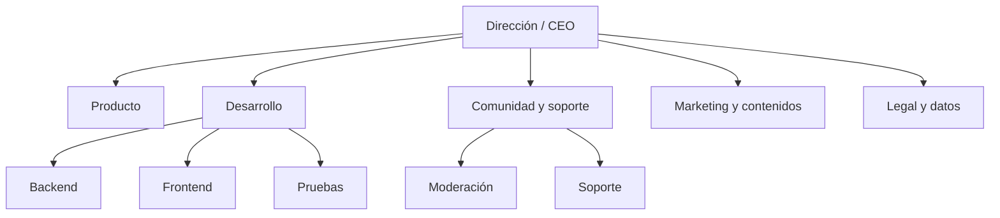

# 01 · Análisis y documentación inicial (RA1)

## 1. Sector y empresas (CE 1a, 1b)

Sector: plataformas y estudios de **sim racing** (simulación de conducción competitiva en PC/consola). Se clasifican por su rol: desarrolladores de simuladores, plataformas de competición/ligas y herramientas de análisis/leaderboards.

| # | Empresa | País | Tipo | Producto / servicio principal |
|---|---|---|---|---|
| 1 | iRacing.com Motorsport Simulations | EEUU | Desarrollador + plataforma online | Simulador por suscripción con licencias, carreras oficiales y leaderboards in-game |
| 2 | Kunos Simulazioni | Italia | Desarrollador de simulador | Assetto Corsa / ACC / AC EVO (simulador de conducción) |
| 3 | Studio 397 | Países Bajos | Desarrollador de simulador | rFactor 2 y Le Mans Ultimate |
| 4 | Reiza Studios | Brasil | Desarrollador de simulador | Automobilista 2 |
| 5 | SimGrid (Speed Capital Ltd) | Reino Unido | Plataforma de ligas/comunidades | Organización de campeonatos, comunidades y leaderboards |
| 6 | Low Fuel Motorsport (255 Systems UG) | Alemania | Plataforma de competición | Carreras organizadas y hotlaps para ACC/AC/AMS2 |
| 7 | Simracing.gp | (no verificado) | Plataforma de campeonatos | Campeonatos multijuego con servidores dedicados |

**Empresa tipo (plataforma de sim racing SaaS).** Organigrama de una empresa tipo del sector (estimado, no corresponde a una empresa real concreta):

Funciones por departamento: Dirección (estrategia, financiación), Producto (roadmap, requisitos), Desarrollo (backend/frontend/QA), Comunidad y soporte (moderación, atención al usuario, eventos), Marketing (contenidos, redes, patrocinios), Legal y datos (RGPD, términos, licencias).

## 2. Necesidades y oportunidades (CE 1c, 1d)

Necesidades priorizadas (criterio: impacto en el piloto aficionado/competitivo y frecuencia de uso; fuente: observación del problema y soluciones del SOTA):

| Prioridad | Necesidad | Fuente |
|---|---|---|
| 1 | Comparar tiempos en igualdad de condiciones (mismo sim/circuito/coche) | SOTA §2 (leaderboards por combo) |
| 2 | Aprender de otros (video + comentarios/guía de la vuelta) | 00-documentoInicio §3-4 |
| 3 | Unificar en un sitio tiempo, trazada y setup | 00-documentoInicio §4 |
| 4 | Competir en torneos/ligas (no imprescindible) | 00-documentoInicio §6 |

Oportunidades de negocio (datos cuantitativos públicos):
- iRacing supera los **350.000 sim racers** registrados (fuente: iracing.com, acceso 2026-11-19).
- SimGrid declara más de **300.000 pilotos** y **2.800 comunidades** (fuente: pits.thesimgrid.com/about-us, acceso 2026-11-19).
- Low Fuel Motorsport declara más de **330.000 usuarios** (fuente: lowfuelmotorsport.com, acceso 2026-11-19).
- El SimRacing Expo 2025 tuvo **24.371 visitantes** (fuente: sim.racing, acceso 2026-11-19).

## 3. Tipo de proyecto elegido (CE 1e)

**Aplicación web full-stack** (backend Java + Spring Boot, frontend web en JavaScript, base de datos MySQL), frente a:
- App móvil nativa: mayor coste y curva, fuera del ciclo.
- Aplicación de escritorio: menor alcance y distribución.
- Solo frontend con datos en hoja de cálculo: no escala ni permite comentarios/comunidad.

Se elige web por integrar los módulos del ciclo (cliente, servidor, despliegue, interfaces) y por ser el formato habitual de las soluciones del sector.

## 4. Requisitos y restricciones (CE 1f)

Numera RF (funcional), RNF (no funcional), REST (restricción). Cada uno con medida o prueba.

| ID | Requisito | Tipo | Cómo se verifica |
|---|---|---|---|
| RF-01 | Registrar un tiempo de vuelta (simulador, circuito, coche, tiempo, fecha, usuario) | funcional | Prueba de alta y consulta en BD |
| RF-02 | Mostrar ranking filtrable por simulador/circuito/coche, ordenado por tiempo asc. | funcional | Prueba con datos de ejemplo |
| RF-03 | Adjuntar enlace de video a un registro | funcional | Prueba de guardado y reproducción |
| RF-04 | Publicar comentarios en un registro | funcional | Prueba de alta/listado |
| RF-05 | Crear y gestionar torneos | funcional (prescindible) | Prueba de CRUD |
| RF-06 | Registro e inicio de sesión de usuarios | funcional | Prueba de autenticación |
| RF-07 | Buscar registros por texto | funcional | Prueba de búsqueda |
| RNF-01 | Listados responden en menos de 2 s con hasta 10.000 registros | no funcional | Medición con datos de prueba |
| RNF-02 | Contraseñas almacenadas con hash (bcrypt/argon2) | no funcional | Revisión de código/BD |
| RNF-03 | Interfaz responsive (móvil y escritorio) | no funcional | Prueba en 2 viewports |
| RNF-04 | Accesibilidad WCAG 2.1 nivel AA (parcial) | no funcional | Revisión manual |
| RNF-05 | Disponibilidad del 99% en horario de uso | no funcional | Monitorización (pendiente) |
| REST-01 | Entrega según calendario académico (H1 26-nov-2026, H2 21-ene-2027) | restricción | Calendario del módulo |
| REST-02 | Tecnología obligatoria: Java + MySQL (ciclo) | restricción | Revisión del stack |
| REST-03 | Sin datos personales reales; solo datos de ejemplo | restricción | Revisión de datos |
| REST-04 | Repositorio público: sin claves ni secretos | restricción | Revisión de repositorio |

### Matriz de trazabilidad

| Objetivo | Requisito | Caso de uso | Pantalla o endpoint | Prueba o indicador |
|---|---|---|---|---|
| OBJ-01 Publicar registro de vuelta | RF-01, RF-03, RF-04 | CU-01 Alta de hotlap | POST /hotlaps | Prueba de aceptacion: se registra un hotlap con video y comentario y se consulta en BD |
| OBJ-02 Explorar rankings filtrables | RF-02, RF-07 | CU-02 Consulta de ranking | GET /hotlaps | Prueba con datos de ejemplo: ranking filtrado y ordenado en menos de 2 s |
| OBJ-03 Gestionar usuarios | RF-06 | CU-03 Registro/login | POST /auth/* | Prueba de autenticacion y revision de hash de contraseñas |
| OBJ-04 Crear torneos (prescindible) | RF-05 | CU-04 Gestión de torneo | /tournaments | Prueba CRUD de torneo (funcionalidad prescindible) |

## 5. Obligaciones fiscales, laborales y de prevención (CE 1g)

Proyecto académico sin actividad económica real: **no aplica** IVA/IRPF por actividad. Se documentan las que aplicarían si se comercializara:
- Alta censal y obligaciones tributarias (IAE, IVA, IRPF/IS) si hubiera ingresos. Estado: sin leer (no aplica: proyecto academico sin actividad economica).
- Protección de datos: RGPD (Reglamento (UE) 2016/679) y LOPDGDD (Ley Orgánica 3/2018) — enlace BOE verificado: https://www.boe.es/buscar/act.php?id=BOE-A-2018-16673 (acceso 2026-11-19). Estado: leido.
- Cookies y servicios de la sociedad de la información: Ley 34/2002 (LSSI) — https://www.boe.es/buscar/act.php?id=BOE-A-2002-13758. Estado: sin leer.
- Prevención de riesgos laborales si hubiera empleados: Ley 31/1995 — https://www.boe.es/buscar/act.php?id=BOE-A-1995-24292. Estado: sin leer.
- Propiedad intelectual de logos, videos y contenidos de terceros. Estado: sin leer.

## 6. Ayudas y subvenciones (CE 1h)

Ayuda real: **Programa Pyme Digital 2026** (Cámara de Comercio de Avilés), BDNS 927280, cofinanciado FEDER. Fuente: https://www.subvenciones.gob.es/bdnstrans/A03/es/convocatorias/927280 (acceso 2026-11-26) y extracto BOPA https://miprincipado.asturias.es/bopa/2026/09/09/2026-07348.pdf. Quién puede pedirla: pymes de la demarcación territorial de la Cámara de Comercio de Avilés, dadas de alta en el censo del IAE (excluidas empresas proveedoras de soluciones de digitalización). Qué cubre: soluciones TIC subvencionadas al 60%, hasta 4.494 euros por empresa sobre presupuesto elegible maximo de 7.490 euros. Plazo: 01/09/2026 a 16/10/2026. Estado: cerrada (no solicitada). No aplicable directamente a un proyecto académico; se documenta como ejemplo real.

## 7. Guion de trabajo (CE 1i)

Fases e hitos (responsable: alumno; tablero en GitHub Projects del repositorio):

| Fase | Fechas | Tareas principales | Responsable | Hito |
|---|---|---|---|---|
| 1 Análisis | hasta 26-nov-2026 | Estudio del sector, requisitos, obligaciones y ayudas | Yo | H1 26-nov-2026 |
| 2 Diseño | 26-nov a 10-dic-2026 | Viabilidad, alcance, arquitectura y datos | Yo; tutor revisa | |
| 3 Planificación | 10-dic a 21-ene-2027 | Cronograma, riesgos y presupuesto | Yo | H2 21-ene-2027 |
| 4 Implementación | 21-ene a 31-mar-2027 | Backend Java/Spring, frontend JS, primera versión mínima funcional | Yo | |
| 5 Pruebas | 1-abr a 23-abr-2027 | Plan de pruebas y corrección de fallos | Yo | |
| 6 Despliegue | 26-abr a 7-may-2027 | Puesta en marcha y guía de despliegue | Yo | H3 7-may-2027 |
| 7 Cierre | hasta 18-jun-2027 | Memoria y defensa | Yo; tutor evalúa | |

## 8. Glosario

| Término | Definición | Sinónimos que NO uso |
|---|---|---|
| Hotlap | Vuelta rápida registrada en un circuito con un coche | "récord", "mejor vuelta" |
| Setup | Configuración del coche (presión, alerones, etc.) | "reglaje", "ajuste" |
| Telemetría | Datos de la vuelta (velocidad, frenada, etc.) | "datos de carrera" |
| BoP | Balance de Prestaciones entre coches | "handicap" |
| Split | División de pilotos por nivel en una carrera | "grupo" |
| Sector | Parte del circuito usada para medir tiempos parciales | "tramo" |

---

## Criterios de evaluación de este documento (RA1, texto literal)

- **1a)** Se han clasificado las empresas del sector por sus características organizativas y el tipo de producto o servicio que ofrecen.
- **1b)** Se han caracterizado las empresas tipo indicando la estructura organizativa y las funciones de cada departamento.
- **1c)** Se han identificado las necesidades más demandadas a las empresas.
- **1d)** Se han valorado las oportunidades de negocio previsibles en el sector.
- **1e)** Se ha identificado el tipo de proyecto requerido para dar respuesta a las demandas previstas.
- **1f)** Se han determinado las características específicas requeridas al proyecto.
- **1g)** Se han determinado las obligaciones fiscales, laborales y de prevención de riesgos y sus condiciones de aplicación.
- **1h)** Se han identificado posibles ayudas o subvenciones para la incorporación de nuevas tecnologías de producción o de servicio que se proponen.
- **1i)** Se ha elaborado el guión de trabajo que se va a seguir para la elaboración del proyecto.
